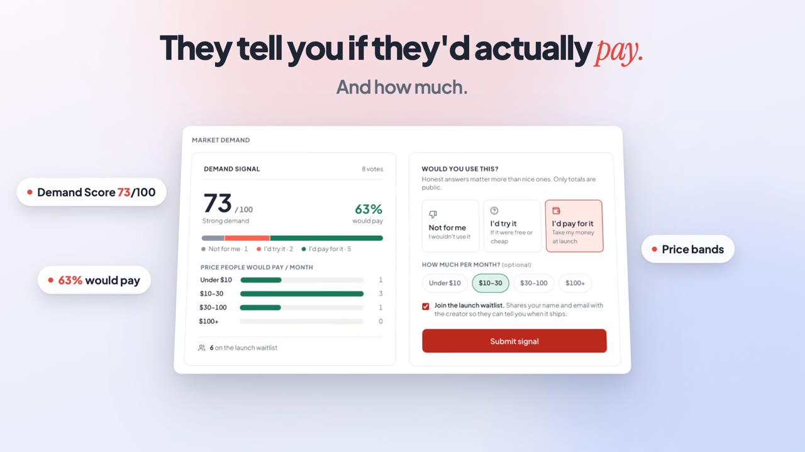

# BusinessListe — Community Idea Validation & Rating Platform

> A production-grade, full-stack web application where innovators submit project and product ideas, and the community evaluates them with structured 1–5 star ratings, detailed reviews, and algorithmic leaderboards.


**🌐 Live:** [businessliste.com](https://businessliste.com/feed)

## 🎬 Launch Video

[](docs/media/ideapulse-launch.mp4)

▶️ **[Watch the launch video (40s, with voiceover)](docs/media/ideapulse-launch.mp4)**

---

## 🚀 Key Features

1. **Authentication & Session Security**:
   - Secure email + password signup & login with bcrypt (12 rounds, 8+ char passwords, timing-safe).
   - **Continue with Google / GitHub** (OAuth 2.0 authorization code flow with signed `state`, PKCE for Google, verified emails only).
   - JWT sessions stored exclusively in `httpOnly` cookies; Origin-checked CSRF protection; strict CORS allowlist.
   - "Sign out of all devices" revokes every issued session.
   - Protected routes across both frontend and backend.
   - Rate limiting on auth attempts (`express-rate-limit`) and helmet security headers.

2. **Rapid Idea Submission (< 30 Seconds)**:
   - Streamlined submission flow with real-time character counters.
   - Categorization across **Tech**, **Business**, **Design**, **Social**, **Education**, and **Other**.
   - Tag chips with dynamic keyboard interaction.
   - Live interactive card preview before publishing.
   - Author edit and delete permissions.

3. **Community Rating & Review System**:
   - 1–5 star interactive rating with hover preview and optimistic UI updates.
   - Strict business rules: **one rating per user per idea** (upsertable) and **no self-rating** (authors cannot rate their own ideas).
   - Optional detailed review commentary with each rating.

4. **Database-Calculated Rating Breakdown**:
   - Real-time rating statistics computed entirely in SQL via `idea_stats_view` (not in the frontend).
   - Overall average score (rounded to 2 decimal places).
   - Total rating counts.
   - 5★ down to 1★ distribution progress bars with counts and percentages.

5. **Discovery Feed**:
   - Instant search across idea titles, pitches, and descriptions.
   - Category filtering pills (All, Tech, Business, Design, Social, Education, Other).
   - Multi-mode sorting:
     - **Top Rated**: Highest average score with rating volume tie-breaker.
     - **Trending**: Recency and activity score based on time-decayed rating counts.
     - **Newest First**: Chronological submission order.
     - **Most Rated**: Ideas with highest community engagement.
   - Pagination with page boundaries and empty states.

6. **Interactive Idea Detail Page**:
   - Complete proposal description and execution plan.
   - Community rating breakdown and interactive star rating widget.
   - Threaded discussion comments with author badges and moderation deletion.
   - Share button (Web Share API with clipboard fallback).
   - Moderation flag/report modal.

7. **Leaderboard**:
   - Filterable by **This Week**, **This Month**, and **All-Time Legends**.
   - Top 3 Podium showcase with Gold, Silver, and Bronze trophies.
   - Ranked index of top community innovations.

8. **Creator Profiles**:
   - Public creator profile with avatar, biography, and member tenure.
   - Aggregated metrics: **Submitted Ideas Count**, **Ratings Given Count**, and **Average Score Received** across all submitted ideas.
   - Tabbed views for "Submitted Ideas" and "Ratings Given".

9. **Market Demand Validation**:
   - Beyond star ratings, voters answer *"Would you use this?"*: **Not for me**, **I'd try it**, or **I'd pay for it**, with an optional monthly price band.
   - Each idea shows a 0–100 **Demand Score**, the share of voters who would pay, and a willingness-to-pay distribution.
   - Voters can opt in to a **launch waitlist**. Only the creator sees it, and can export it to CSV (with spreadsheet-injection-safe cells).

10. **Product Waitlist**:
   - "Join the waitlist" card on the landing page (email, optional name and use case) with honeypot and rate-limit spam protection.
   - Admin **Waitlist** dashboard (`/admin/waitlist`): total / last 7 days / today, signups-per-day chart, latest signups, and CSV export.

11. **Content Moderation & Admin Role**:
   - Any authenticated user can report an idea with violation reasons.
   - Dedicated **Admin Moderation Hub** (`/admin`) for administrators to inspect reported items, filter by status (`pending`, `resolved`, `dismissed`), resolve reports, or delete infringing content and comments.

12. **Aesthetics & Accessibility**:
    - Tailored typography pairing: **Plus Jakarta Sans** for headings and **Inter** for clean UI legibility.
    - Full Light and Dark mode with system preference auto-detection and persistence.
    - Sonner toasts for all user actions.
    - Fully responsive across mobile (360px), tablet (768px), and desktop (1440px).

---

## 🛠️ Tech Stack

### Frontend (`/client`)
- **Core**: React 18 + Vite (JavaScript JSX, zero TypeScript)
- **Styling**: Tailwind CSS with custom CSS variable design tokens
- **Components**: Radix UI inspired primitives (Button, Input, Textarea, Dialog, Badge, Card, Skeleton)
- **Icons**: `lucide-react`
- **Routing**: `react-router-dom` v6
- **Data Fetching & Caching**: `@tanstack/react-query` v5
- **Form Management & Validation**: `react-hook-form` + `zod` + `@hookform/resolvers`
- **Animations**: `framer-motion`
- **Notifications**: `sonner`

### Backend (`/server`)
- **Runtime**: Node.js (ES Modules)
- **Framework**: Express 4
- **Database**: SQLite via `better-sqlite3` with plain SQL migrations portable to PostgreSQL
- **Security**: `helmet`, `cors`, `express-rate-limit`, `cookie-parser`
- **Auth**: `jsonwebtoken`, `bcryptjs`
- **Validation**: `zod` validation middleware for all endpoints
- **Testing**: Built-in Node test runner (`node:test` + `node:assert`)

---

## 📂 Project Structure

```
/Users/radhe/Publicreview
├── package.json              # Root scripts (dev, migrate, seed, test)
├── README.md                 # Complete documentation
├── .env.example              # Root environment template
│
├── server/
│   ├── package.json
│   ├── .env.example
│   ├── src/
│   │   ├── app.js            # Express application setup & security middleware
│   │   ├── server.js         # HTTP server entrypoint & port listener
│   │   ├── config/
│   │   │   ├── db.js         # better-sqlite3 connection with foreign keys & WAL
│   │   │   └── env.js        # Environment configuration
│   │   ├── db/
│   │   │   ├── migrations/
│   │   │   │   └── 001_initial_schema.sql  # Normalized schema & idea_stats_view
│   │   │   ├── migrate.js    # Migration runner
│   │   │   └── seed.js       # Seed script (11 realistic users, 22 ideas, 100+ ratings)
│   │   ├── middleware/
│   │   │   ├── auth.js       # requireAuth, optionalAuth, requireAdmin, cookies
│   │   │   ├── error.js      # Centralized error handler & 404 handler
│   │   │   ├── rateLimiter.js# Express rate limiters
│   │   │   └── validate.js   # Zod request validator
│   │   ├── controllers/
│   │   │   ├── auth.controller.js
│   │   │   ├── idea.controller.js
│   │   │   ├── rating.controller.js
│   │   │   ├── comment.controller.js
│   │   │   ├── leaderboard.controller.js
│   │   │   ├── user.controller.js
│   │   │   └── report.controller.js
│   │   ├── routes/
│   │   │   ├── auth.routes.js
│   │   │   ├── ideas.routes.js
│   │   │   ├── leaderboard.routes.js
│   │   │   ├── user.routes.js
│   │   │   └── report.routes.js
│   │   └── validations/
│   │       └── index.js      # Centralized Zod schemas
│   └── tests/
│       └── rating.test.js    # Unit & business logic tests for ratings
│
└── client/
    ├── package.json
    ├── vite.config.js        # Vite config with API proxy (/api -> http://localhost:5001)
    ├── tailwind.config.js    # Custom palette, typography, and tokens
    ├── postcss.config.js
    ├── index.html            # Preconnected fonts & SEO metadata
    └── src/
        ├── api/
        │   └── client.js     # Fetch API wrapper with credentials: 'include'
        ├── context/
        │   ├── AuthContext.jsx   # Session management & user state
        │   └── ThemeContext.jsx  # Dark/light mode system sync
        ├── components/
        │   ├── ui/               # Button, Input, Textarea, Badge, Card, Skeleton, Dialog
        │   ├── navbar.jsx        # Responsive navigation with user dropdown & theme toggle
        │   ├── footer.jsx        # Footer with links and stack info
        │   ├── idea-card.jsx     # Card with hover elevation, rating badge, and tags
        │   ├── category-badge.jsx# Category pills with contextual icons
        │   ├── star-rating-widget.jsx # Interactive 1-5 star selector with review input
        │   ├── rating-breakdown.jsx   # Average score & 5-to-1 star distribution bars
        │   ├── comment-section.jsx    # Discussion thread with moderation delete
        │   ├── report-modal.jsx       # Modal to flag an idea
        │   └── confirmation-dialog.jsx# Accessible confirmation modal for delete actions
        ├── pages/
        │   ├── landing-page.jsx       # Hero, stats, top ideas, how it works
        │   ├── feed-page.jsx          # Search, category pills, sort select, pagination
        │   ├── idea-detail-page.jsx   # Full pitch, ratings breakdown, comments
        │   ├── submit-idea-page.jsx   # <30s flow, tag chips, live card preview
        │   ├── edit-idea-page.jsx     # Pre-filled edit form with permission check
        │   ├── leaderboard-page.jsx   # Gold/Silver/Bronze podium & rankings
        │   ├── profile-page.jsx       # Creator bio, metrics, and activity tabs
        │   ├── login-page.jsx         # Login form with 1-click demo buttons
        │   ├── signup-page.jsx        # Registration form
        │   ├── admin-moderation-page.jsx # Flagged content review hub
        │   └── not-found-page.jsx     # Friendly 404 page
        ├── lib/
        │   └── utils.js      # cn() class merging and date helpers
        ├── App.jsx           # App routes & providers
        ├── main.jsx          # React DOM entry
        └── index.css         # Tailwind directives & CSS variables
```

---

## ⚡ Quick Start & Setup

### Prerequisites
- Node.js v18+ (tested on v24)
- npm v9+

### 1. Installation
Clone the repository and install all dependencies:
```bash
# From the root directory:
npm run install:all
```

### 2. Environment Variables
Both client and server come with preconfigured `.env.example` files:
```bash
cp server/.env.example server/.env
```
Default `server/.env`:
```env
PORT=5001
NODE_ENV=development
CLIENT_URL=http://localhost:5173
JWT_SECRET=ideapulse_development_jwt_secret_key_minimum_32_characters_random
DATABASE_PATH=./src/db/ideapulse.db
```

### 3. Run Database Migrations & Seed Data
```bash
# Apply SQL schema migrations
npm run migrate

# Seed 11 realistic users, 22 diverse ideas, and 100+ ratings
npm run seed
```

### 4. Run the Tests
```bash
npm test
```
*Runs automated unit tests for rating bounds (1-5), single-rating upsert, self-rating prevention, and SQL view aggregations.*

### 5. Start the Application (Dev Server)
```bash
npm run dev
```
- **Client**: [http://localhost:5173](http://localhost:5173)
- **API Server**: [http://localhost:5001](http://localhost:5001)

---

## 🔑 Demo Accounts (Pre-Seeded)

All seeded accounts use password: `password123`

| Name | Email | Role | Features to Explore |
|------|-------|------|---------------------|
| **Elena Rostova** | `admin@ideapulse.dev` | `admin` | Full moderation hub (`/admin`), delete ideas/comments, resolve reports |
| **Marcus Chen** | `marcus@techventures.io` | `user` | Author of *DevPulse*, test self-rating prevention on his own ideas |
| **Sophia Patel** | `sophia@designstudio.co` | `user` | Author of *PaletteCraft*, rate other creators' ideas |

*Tip: The `/login` page features 1-click quick-fill buttons for both Elena and Marcus!*

---

## 📡 RESTful JSON API Reference (`/api/v1`)

All endpoints return a consistent JSON payload structure:
```json
// Success Response
{
  "success": true,
  "data": { ... },
  "message": "Optional user-friendly message"
}

// Error Response
{
  "success": false,
  "error": {
    "message": "Human readable error description",
    "details": ["Optional array of validation error strings"]
  }
}
```

### 1. Authentication (`/api/v1/auth`)

#### `POST /auth/register`
Create a new user account and set the JWT session cookie.
```bash
curl -X POST http://localhost:5001/api/v1/auth/register \
  -H "Content-Type: application/json" \
  -d '{
    "name": "Jane Doe",
    "email": "jane@example.com",
    "password": "securepassword123",
    "bio": "Building the future of open web tools."
  }'
```

#### `POST /auth/login`
Authenticate existing user and issue httpOnly cookie.
```bash
curl -X POST http://localhost:5001/api/v1/auth/login \
  -H "Content-Type: application/json" \
  -d '{
    "email": "marcus@techventures.io",
    "password": "password123"
  }'
```

#### `POST /auth/logout`
Clears the JWT session cookie.

#### `GET /auth/me`
Retrieve the authenticated user's profile and summary counts.
```bash
curl -X GET http://localhost:5001/api/v1/auth/me \
  -H "Cookie: ideapulse_token=<TOKEN>"
```

---

### 2. Ideas (`/api/v1/ideas`)

#### `GET /ideas`
Query ideas with pagination, search, category filter, and sorting.
- **Query Parameters**:
  - `page` (default: 1)
  - `limit` (default: 12)
  - `category` (`Tech`, `Business`, `Design`, `Social`, `Education`, `Other`)
  - `sort` (`top`, `trending`, `newest`, `most_rated`)
  - `search` (keyword search)
  - `tag` (tag filter)

```bash
curl "http://localhost:5001/api/v1/ideas?page=1&limit=6&category=Tech&sort=top"
```

#### `GET /ideas/:id`
Retrieve full idea details, author information, rating breakdown distribution, and current user's rating.
```bash
curl "http://localhost:5001/api/v1/ideas/1"
```

#### `POST /ideas` *(Protected)*
Submit a new idea.
```bash
curl -X POST http://localhost:5001/api/v1/ideas \
  -H "Content-Type: application/json" \
  -H "Cookie: ideapulse_token=<TOKEN>" \
  -d '{
    "title": "SubScript: Smart Code Snippet Versioning",
    "pitch": "Instant gist-like code snippets with live collaborative execution and execution diffs.",
    "description": "SubScript lets developers share reproducible terminal snippets and scripts with sandboxed execution.",
    "category": "Tech",
    "tags": ["DeveloperTools", "Productivity"]
  }'
```

#### `PUT /ideas/:id` *(Protected: Author or Admin)*
Update an existing idea.

#### `DELETE /ideas/:id` *(Protected: Author or Admin)*
Permanently delete an idea and cascade delete its ratings and comments.

---

### 3. Ratings (`/api/v1/ideas/:id/ratings`)

#### `GET /ideas/:id/ratings`
List all individual ratings and reviews given to an idea.

#### `GET /ideas/:id/ratings/my` *(Protected)*
Retrieve the current authenticated user's rating on this idea.

#### `POST /ideas/:id/ratings` *(Protected)*
Submit or update a 1–5 star rating with optional review text.
- Rejects self-ratings (`400 You cannot rate your own idea.`)
- Rejects scores < 1 or > 5 (`400 Validation failed`)
- Automatically upserts: updates existing rating without creating duplicates.
```bash
curl -X POST http://localhost:5001/api/v1/ideas/1/ratings \
  -H "Content-Type: application/json" \
  -H "Cookie: ideapulse_token=<TOKEN>" \
  -d '{
    "score": 5,
    "review_text": "Remarkable concept! Solves a massive pain point."
  }'
```

#### `DELETE /ideas/:id/ratings` *(Protected)*
Remove the user's rating and recalculate community statistics.

---

### 4. Comments (`/api/v1/ideas/:id/comments`)

#### `GET /ideas/:id/comments`
List discussion comments on an idea in reverse chronological order.

#### `POST /ideas/:id/comments` *(Protected)*
Post a new comment.
```bash
curl -X POST http://localhost:5001/api/v1/ideas/1/comments \
  -H "Content-Type: application/json" \
  -H "Cookie: ideapulse_token=<TOKEN>" \
  -d '{
    "content": "Are there plans to release an open source CLI client?"
  }'
```

#### `DELETE /ideas/comments/:commentId` *(Protected: Author or Admin)*
Delete a comment.

---

### 5. Leaderboard (`/api/v1/leaderboard`)

#### `GET /leaderboard`
Retrieve ranked top ideas.
- **Query Parameters**:
  - `timeframe`: `week`, `month`, `all` (default: `all`)
  - `limit`: default `20`

```bash
curl "http://localhost:5001/api/v1/leaderboard?timeframe=week"
```

---

### 6. Users (`/api/v1/users`)

#### `GET /users/:id`
Retrieve public user profile and statistics (ideas count, ratings given, average score received).

#### `GET /users/:id/ideas`
List ideas submitted by this creator.

#### `GET /users/:id/ratings`
List ratings and reviews given by this creator.

---

### 7. Moderation Reports (`/api/v1/reports`)

#### `POST /reports` *(Protected)*
Flag an idea for moderation review.
```bash
curl -X POST http://localhost:5001/api/v1/reports \
  -H "Content-Type: application/json" \
  -H "Cookie: ideapulse_token=<TOKEN>" \
  -d '{
    "idea_id": 2,
    "reason": "Suspected duplicate submission of an earlier concept."
  }'
```

#### `GET /reports` *(Protected: Admin Only)*
List all reports with optional `?status=pending` filter.

#### `PATCH /reports/:id` *(Protected: Admin Only)*
Update report status to `resolved` or `dismissed`.

---

## 🔒 Security Design

- **Parameterized SQL**: All database queries use prepared statements with parameterized inputs (`?`), guaranteeing immunity to SQL injection.
- **XSS Protection**: HTML entities are not rendered as raw HTML. React handles standard variable escaping, and express enforces strict JSON formatting.
- **Credential Storage**: Passwords are salted and hashed using `bcrypt` (10 rounds).
- **Session Protection**: JWT authentication tokens are transmitted inside `httpOnly`, `SameSite=Lax` cookies, shielding them from client-side script access.
- **Restricted CORS**: Cross-Origin requests are explicitly restricted to `CLIENT_URL`.
- **Rate Limiting**: Protects sensitive endpoints (30 login attempts / 15 minutes, 300 general API requests / 15 minutes).

---

## 📄 License
MIT License. Built for innovation communities and builders everywhere.
